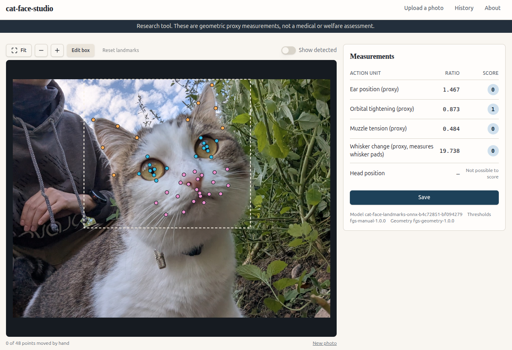
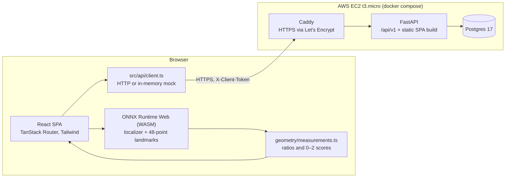

# KittyFace (cat-face-studio)



Geometric proxy measurements of a cat's face from a single photo, inspired by the Feline Grimace Scale.

**Live app:** https://18.197.170.116.sslip.io/

> Research tool. These are geometric proxy measurements, not a medical or welfare assessment.

## The problem

I have a wonderful cat: medium-fluffy, pleasantly plump and well-mannered. On our daily walks she hunts grasshoppers, spiders and, if I'm not watching, mice and birds.

Her one flaw is hyperthyroidism. It's treatable, but methimazole was developed for humans, and the pills sometimes upset her digestion and mood. Add tree climbing with clumsy landings, and I often can't tell if she's okay.

Vets wonder too. One tool they use is the [Feline Grimace Scale](https://doi.org/10.1038/s41598-019-55693-8) (FGS, Evangelista et al., 2019): a trained observer scores five facial action units 0, 1 or 2 (ear position, orbital tightening, muzzle tension, whisker change, head position). Scoring by eye is subjective and needs training most owners don't have. The authors have an app, but it's a training guide and doesn't score pain.

Much of the FGS is geometry: how far apart the ears are, how open the eyes are, how round the muzzle is. A landmark model measures that consistently. So, armed with Claude, Connected Papers and Hugging Face, I built KittyFace. It detects 48 facial landmarks in the browser, lets you correct them, and turns them into one ratio and one 0–2 proxy score per action unit. Photos and intermediate results are stored, so they can be re-scored as the cut-offs improve.

KittyFace does not apply the FGS and is not a pain or health assessment. The cut-offs are provisional research values.

## What the system does

1. **Consent.** On the first visit, a modal shows the privacy and research-use notice. Nothing works until the user presses "I agree". The consent is recorded on the server with the notice version.
2. **Upload.** The user drops or picks one JPEG, PNG or WebP photo of up to 5 MB. Other files are rejected in the browser with a message. The browser reads the EXIF orientation, shows the image upright, and strips all EXIF metadata without re-encoding the pixels.
3. **Detect.** Two ONNX models run in the browser through ONNX Runtime Web: a face localizer draws the head box, and a landmark model places 48 points inside it. The photo does not leave the browser at this stage.
4. **Correct.** The user can move the head box and drag individual landmarks. Confirming a new box re-runs landmark detection on that crop, after a confirmation if points had already been moved.
5. **Measure.** The results panel shows a raw ratio and a 0–2 proxy score for four action units, using versioned cut-offs from the server:

   | Action unit | Metric |
   |---|---|
   | Ear position (proxy) | Ear-tip span divided by outer-eye-corner span |
   | Orbital tightening (proxy) | Eyelid height divided by eye width, averaged over both eyes |
   | Muzzle tension (proxy) | Minor/major axis ratio of the muzzle outline's ellipse |
   | Whisker change (proxy) | Angle of the whisker pads against the muzzle sides |
   | Head position | Always "Not possible to score" from a face photo |

   No total score is shown. The word "pain" appears only on the About page.
6. **Save.** Only when the user presses Save does the browser upload the stripped photo with its metadata. The metadata covers orientation, the detector and final boxes, model and user landmarks, which points moved, measurements for both landmark sets, and the model, threshold, geometry and notice versions. The server validates the schema and answers 422 naming the first failed check.
7. **History.** `/history` lists this browser's saved uploads, newest first. `/history/<id>` opens one read-only in the editor, and each upload can be deleted.

There are no accounts. A random 32-character hex token in `localStorage` links a browser to its uploads, and the server only returns uploads that belong to the token in the request. After each detection attempt, the browser also sends an anonymous event with outcome, load time, inference time, backend and model version. The event carries no token, IP address or image.

## Architecture



| Layer | Technology | Role |
|---|---|---|
| Frontend | React 19, TypeScript, Vite, TanStack Router, Tailwind 4, shadcn/ui, bun | Upload, editor, results, history and About pages. Prototyped in Lovable and maintained by hand since. |
| In-browser ML | ONNX Runtime Web (WASM) | Runs the localizer and landmark models, so photos stay on the device until Save |
| API contract | [`openapi.yaml`](openapi.yaml) (OpenAPI 3.1) | Written from what the frontend needs. The backend implements it. |
| Backend | Python 3.12, FastAPI, Pydantic, SQLAlchemy, uv | Config, consent, uploads and events under `/api/v1`. Also serves the built SPA at `/`. |
| Database | Postgres 17 through psycopg, Alembic migrations | Migrations run on start. `DATABASE_URL` selects the database. |
| Research track | `src/kittyface/core`, `scripts/` | Python reference geometry, tflite-to-ONNX export, and the cut-off fit that produces `models/thresholds.json` |
| Containers | Multi-stage `Dockerfile`, `docker-compose.yaml` | One image: a Node stage builds the frontend, a Python stage runs the backend. Compose adds Postgres. |
| Deploy | CloudFormation, ECR, SSM, Caddy, sslip.io | `make deploy` builds and pushes the image, then restarts compose on the instance over SSM |

**Python and TypeScript must agree.** The browser computes ratios and scores, and `kittyface.core.geometry` is the reference implementation. `frontend/src/geometry/measurements.ts` is a hand port of it. A Vitest parity test pins the Python values, and the Playwright suite checks the deployed app against the Python pipeline on real photos.

## Quickstart (Docker)

You need Docker and [Git LFS](https://git-lfs.com). The ONNX models are stored in LFS.

```sh
git lfs install
git clone https://github.com/Miffka/kittyface && cd kittyface
cp .example.env .env      # then set a real POSTGRES_PASSWORD
make docker-up            # docker compose up --build: app + Postgres
```

Open http://localhost:8091. The database is in the `kittyface-pg` volume. Stop with `make docker-down`. `docker compose down -v` also deletes the data.

To see example data, set the browser's client token in `localStorage` to 32 zeros. That is the pre-consented demo token that owns the three seed uploads.

## Local development

You need [uv](https://docs.astral.sh/uv/), [bun](https://bun.sh) and Docker for Postgres.

```sh
cp .example.env .env      # once
uv sync                   # backend and dev dependencies
(cd frontend && bun install)
make db                   # Postgres only, on localhost:5433
make run                  # backend on :8091 and the Vite dev server on :8080, together
```

The frontend can also run without any backend: `cd frontend && VITE_USE_MOCK_API=true bun --bun run dev`. Every backend call goes through `src/api/client.ts`, which then switches to an in-memory mock.

Useful extras:

- `uv run alembic revision --autogenerate -m "<message>"` writes a migration after model changes. `tests/backend/test_migrations.py` fails while models and migrations differ.
- `uv sync --group train --group dev` adds the research-track dependencies (TensorFlow, tf2onnx) for the `scripts/` pipeline.

## Tests

| Suite | Kind | Command | Needs |
|---|---|---|---|
| `tests/test_geometry.py`, `tests/test_export_onnx.py` | Unit tests: geometry metrics, scoring, ONNX export | `make test` | The export test skips without the `train` group |
| `tests/backend/` | Integration tests: the API, migrations and SPA serving against real Postgres, each session in a throwaway database | `make test` | `make db` |
| `frontend/src/test/` | Frontend tests (Vitest): API client and error mapping, mock API, image handling, geometry parity with Python, routing | `cd frontend && bun --bun run test` | Nothing |
| `tests/e2e/` | End to end (Playwright): builds the image, starts its own compose stack on port 18091, uploads the fixture cats in Chromium and compares the results with the Python pipeline | `make test-e2e` | Docker, plus `uv run playwright install chromium` once |

`make test` runs the unit and integration suites together. It leaves out the end-to-end suite because that one needs Docker and a browser.

## Deployment

The live instance is deployed to AWS with one command:

```sh
aws configure             # once, for the target account and region
make deploy               # STACK=<name> deploys another stack; the default is kittyface
```

[`deploy/deploy.sh`](deploy/deploy.sh) creates or updates the CloudFormation stack in [`deploy/cloudformation.yaml`](deploy/cloudformation.yaml). It then builds the image for `linux/amd64`, pushes it to the stack's ECR repo, and pulls and restarts compose on the instance over SSM. It prints the app's URL, `https://<elastic-ip>.sslip.io`.

## How it was built with AI

Development uses a small agent team. The main session is an orchestrator that runs a fixed lifecycle and launches three subagents, each with its own role prompt:

- **PM** ([`docs/team/pm.md`](docs/team/pm.md)) grooms a backlog item into an issue with acceptance criteria.
- **Engineer** ([`docs/team/software-engineer.md`](docs/team/software-engineer.md)) implements one groomed issue.
- **QA** ([`docs/team/qa-engineer.md`](docs/team/qa-engineer.md)) checks every acceptance criterion against the code, runs the tests and returns PASS or FAIL. QA never fixes code itself.

An issue closes only after QA passes it. The lifecycle and its rules are in [`docs/project_process.md`](docs/project_process.md).

- **Specification:** [`docs/frontend_specification.md`](docs/frontend_specification.md) (the spec given to Lovable) and [`docs/PLAN_PROJECT.md`](docs/PLAN_PROJECT.md) (product decisions).
- **Task tracker:** [`docs/backlog.md`](docs/backlog.md) holds every item with acceptance criteria. Groomed issues are in [`docs/issues/`](docs/issues/). [APP-20](docs/issues/APP-20.md) and [RSCH-6](docs/issues/RSCH-6.md) carry full QA verdicts.
- **Agent context:** [`AGENTS.md`](AGENTS.md) links to [`backend/AGENTS.md`](backend/AGENTS.md) and [`frontend/AGENTS.md`](frontend/AGENTS.md), which hold each side's commands, rules and architecture.
- **Logs:** [`docs/AI_WORKFLOW.md`](docs/AI_WORKFLOW.md) records each piece of work: who did it, what was rejected, what was checked by hand, and what went wrong. [`docs/DECISIONS.md`](docs/DECISIONS.md) records the design decisions and their reasons.

## Repository layout

```
frontend/          React SPA (src/api, src/ml, src/geometry, src/components, src/routes, src/test)
backend/           FastAPI app, SQLAlchemy models, Alembic migrations
src/kittyface/     Python reference geometry and landmark graph
scripts/           Research pipeline: fetch weights, detect, export to ONNX, fit thresholds, score images
models/            tflite and ONNX models (Git LFS), manifest.json, thresholds.json
tests/             Python unit tests, backend integration tests (tests/backend), Playwright E2E (tests/e2e)
deploy/            CloudFormation template and deploy script
docs/              Specification, plan, backlog, issues, agent roles, process, AI workflow, decisions
openapi.yaml       API contract
Dockerfile, docker-compose.yaml, Makefile
```

## TODOs

- The cut-offs (`fgs-manual-1.0.0`) are fitted on one FGS training-manual photo per score level. Ears and muzzle order those photos correctly. Orbital tightening and whisker change don't yet, and need better metrics or more labeled photos.
- Production data is not backed up.

## Credits and licences

- The cat face localizer and landmark models are by Hugo Cornellier ([huggingface.co/hugocornellier/cat-face-landmarks](https://huggingface.co/hugocornellier/cat-face-landmarks)), used under CC BY-NC 4.0 and converted to ONNX. Because of this licence, the app is non-commercial.
- Feline Grimace Scale: Evangelista MC et al. (2019), *Facial expressions of pain in cats: the development and validation of a Feline Grimace Scale*, Scientific Reports 9:19128. The FGS is cited only. No FGS images, text or logo are used, and no endorsement is implied.